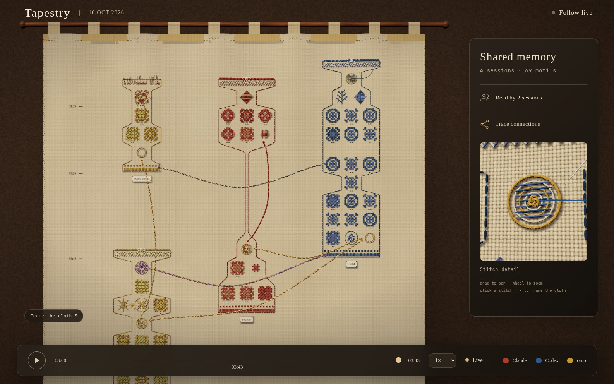
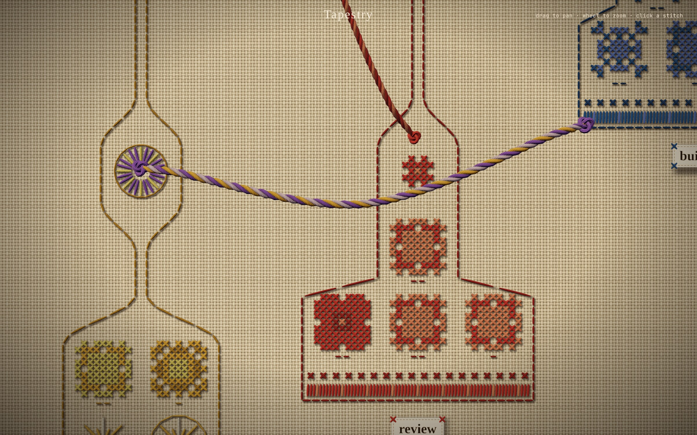

# omarchy-eventloom

One local log of what the AI agents on your machine did.

Eventloom is an Omarchy plugin that records, in a single append-only file per
day, every session your coding agents start and finish, every tool they call,
every approval they ask for, and how each ended. Beside that it keeps a
memory: short summaries the agents write of their own replies, filed by
project and handed to the next session that opens there, whichever agent it
is. It captures omp and Claude
Code out of the box, and anything else can write to it with one command. The
log never leaves the machine, is redacted before anything is written, and is
hash-chained, so a line that was edited or removed afterwards shows up.

```
$ eventloom tail --limit 4
{"ts":"2026-10-12T14:02:11.482Z","type":"agent.session.started","actor":"claude","thread":"claude-0b9a…","payload":{"cwd":"/home/me/app","git_branch":"main","git_dirty":true,…}}
{"ts":"2026-10-12T14:02:19.007Z","type":"agent.tool.completed","actor":"claude","thread":"claude-0b9a…","payload":{"tool":"Bash","tool_input_keys":["command","description"],…}}
{"ts":"2026-10-12T14:02:24.650Z","type":"agent.tool.failed","actor":"omp","thread":"omp-01a1…","payload":{"tool":"read","duration_ms":12,…}}
{"ts":"2026-10-12T14:03:40.118Z","type":"agent.session.completed","actor":"claude","thread":"claude-0b9a…","payload":{"reason":"prompt_input_exit",…}}
```



*The Tapestry, Eventloom's view of the log: each band is a session growing
upward from its start, each stitched design one thing an agent did.*

## Why

Run more than one agent, or one agent for more than an afternoon, and three
questions come up that nothing answers well:

- **What happened while I was not watching?** Each agent keeps its own
  transcript in its own place and format. There is no one place to see that
  omp ran forty tool calls in a repository between two and three, that one
  failed, and that Claude Code then picked the work up.
- **Can I trust the record?** A transcript the agent itself can rewrite is not
  evidence of what it did. Eventloom's log is written by adapters outside the
  agent, sealed as a hash chain, and each day is anchored to the one before,
  so `eventloom verify` notices an edited event, a shortened day and a
  missing one. (What that does and does not protect against is spelled out
  under [Integrity](#integrity).)
- **How do agents find out about each other?** Agents on one machine work
  blind. A shared log gives them, and you, one thing to read: `eventloom tail`
  from a script, a hook or another agent, and a `correlation_id` that ties the
  sessions of different agents to the same task.

It is deliberately a record of *what happened*, not *what was said*. The
bundled adapters log tool names and argument names, never arguments, output
or prompts, so the log is safe to keep and cheap to read. See
[Privacy](#privacy).

## How it works

```
 omp ──extension──┐
                  ├─► eventloom CLI ─► redact ─► seal ─► ~/.local/state/omarchy/agents/logs/
 Claude ──hooks───┘                                         2026-10-12.jsonl   (one per day,
 anything ─ eventloom append / ingest                                           hash-chained)
                                                                 │
                                    eventloom tail · verify · doctor · tapestry
```

- **Adapters** sit outside the agents and use their official extension
  points: an omp extension and Claude Code hooks. They never write to the
  agent's terminal and never block it on a failure.
- **The CLI** is the only writer. It adds where a session ran (host, Omarchy
  release, git branch and commit), redacts, and hands the event to
  [@eventloom/runtime](https://github.com/syndicalt/eventloom), which seals it
  into the day's chain.
- **Readers** are plain commands over plain JSONL, plus the Tapestry, a local
  page that weaves the log into a picture.

## Install

As an Omarchy plugin:

```sh
omarchy plugin add https://github.com/syndicalt/omarchy-eventloom.git --enable
```

Adding only clones the repository. Enabling starts a small background service
(no bar icon, no window) which, a few seconds later, installs everything:

- the `eventloom` CLI into `~/.local/bin`, and its code into
  `~/.local/lib/eventloom` with its two dependencies, `@eventloom/runtime`
  and `three` (for the Tapestry), exactly as `package-lock.json` pins them
  (this is the one step that uses the network);
- the omp extension, if omp is installed;
- the Claude Code hooks, if Claude Code is installed. `~/.claude/settings.json`
  is edited in place: other hooks are kept, the previous contents are saved
  beside it as `settings.json.eventloom-backup`, and a file that cannot be
  parsed is left alone.

It finishes by running `eventloom doctor`, and it runs again by itself after
`omarchy plugin update`. If it cannot finish you get one notification saying
so; the reason is in `omarchy-shell eventloom status`, and running
`install.sh` in a terminal shows it in full. Notifications never quote what
went wrong, because the text of a notification can be read by other users of
the machine while it is being sent. Requires `bun`, or `node >= 20` with
`npm`.

The service answers on the shell's IPC:

```sh
omarchy-shell eventloom status     # {"state":"ready", …}
omarchy-shell eventloom doctor     # run the health check; notifies healthy, or how many problems
omarchy-shell eventloom tapestry   # open the Tapestry in the browser
omarchy-shell eventloom install    # run the installer again now
```

Without the plugin system, clone the repository anywhere and run
`./install.sh`; run it again to upgrade.

## Usage

```sh
eventloom append agent.note.added --actor me --payload '{"text":"hello"}'
eventloom tail --limit 20 --actor omp   # newest events, across shards
eventloom verify                        # every shard and the links between them; exit 2 on failure
eventloom doctor                        # log health and adapter wiring
eventloom recover                       # set a damaged shard aside, keep its verified prefix
eventloom purge 2026-10-10              # delete one day's shard and record that it was
eventloom path                          # today's shard
```

`omarchy-eventloom` and `omarchy-eventloom-inspect` are aliases for
`eventloom` and `eventloom doctor`.

## Memory

A list of tool calls says that something happened, not what it was for. So
agents are asked to say: after a reply that changed, decided or found
something, the agent records one to three sentences about it.

```sh
eventloom note --tags release <<'EOF'
Ran the migration dry run and added the health check to rollback. Tests pass.
EOF

eventloom recall                 # what was recorded for this project (git repository, or directory)
eventloom recall --tag release   # narrowed by tag; also --correlation <id>, --all, --limit, --days, --json
```

- **Written by the agent.** When a session opens, the adapter tells the agent
  how to record a summary and gives it the last 8 recorded for the project.
  Claude Code receives this through its SessionStart hook, omp before the
  session's first turn. Whether a summary gets written is then up to the
  agent: nothing forces it, and some replies will go unrecorded.
- **Shared across agents.** A summary belongs to a project, not to the agent
  that wrote it, so omp starts from what Claude left and the reverse.
- **Recall is recorded too.** Each time summaries are handed to a session an
  `agent.memory.recalled` event names them. That is what makes a memory
  thread: the Tapestry draws a gold thread from each summary to every session
  that read it.
- **Bounded.** A summary is at most 600 characters; longer text is refused so
  the agent shortens it. It is read from standard input, never from the
  command line, and is redacted like everything else.
- **Optional.** `EVENTLOOM_MEMORY=0` stops the briefing and the request for
  summaries. `EVENTLOOM_MODE=metadata` keeps no content, so it does too.

## Events

| Type | Meaning | Emitted by |
|---|---|---|
| `agent.session.started` / `resumed` / `completed` | session lifecycle | omp, claude |
| `agent.model.started` / `completed` | one model turn, with `duration_ms` | omp |
| `agent.tool.started` / `completed` / `failed` | tool calls; inputs as argument names only | omp, claude (no `started`) |
| `agent.approval.requested` / `resolved` | human-in-the-loop | omp |
| `agent.note.added` | free-form annotation | `eventloom append` |
| `agent.reply.summarized` | an agent's summary of its reply, with `project` and `tags` | `eventloom note` |
| `agent.memory.recalled` | summaries handed to a session, by id | `eventloom recall`, session start |
| `eventloom.shard.anchored` | opens a shard; links it to the previous one | the store |
| `eventloom.shard.acknowledged` | a shard was recovered or purged on purpose | `recover`, `purge` |

The tapestry also recognises `agent.session.failed`, `agent.handoff`,
`agent.file.mutated` and `agent.git.mutated`; no bundled adapter emits them
yet. Any well-formed type is accepted and stored, except the `eventloom.*`
types, which only eventloom itself writes.

Adapter payloads carry `session_id`, `correlation_id` and `occurred_at`.
`occurred_at` is when the event happened; the envelope `timestamp` is when it
was sealed. Set `EVENTLOOM_CORRELATION_ID` in an agent's environment to join
its sessions to a task shared with other agents; otherwise each session
correlates only with itself.

## Adapters

- **omp** — `extensions/eventloom.ts`, copied to `~/.omp/agent/extensions/`.
  Queues events in memory and writes them in order through one
  `eventloom ingest` process at a time. At shutdown whatever is still queued
  goes to a second process at once, so omp is never kept waiting; those last
  events can be sealed out of order, and `occurred_at` gives the true one.
- **claude** — `hooks/eventloom-hook.sh`, registered in
  `~/.claude/settings.json` for `SessionStart`, `SessionEnd`, `PostToolUse` and
  `PostToolUseFailure`. `settings.json` is never rewritten if it cannot be
  parsed, other hooks are left in place, and the previous contents are kept
  as `settings.json.eventloom-backup`.

To add an adapter: capture the agent's events out of band (its hooks or
extension API, not a proxy), pipe them to `eventloom ingest` as one
`{"type","actor","thread","payload"}` object per line, and add an entry to
`lib/adapters.json` so `eventloom doctor` checks it.

Adapters never write to the agent's terminal. A failed write goes to
`~/.local/state/omarchy/agents/eventloom-errors.log`, and `eventloom doctor`
reports it.

## Privacy

- Of what an agent does, the bundled adapters record tool names and argument
  names, never arguments, output or prompts. Of what it says, they record
  only the summary the agent itself chooses to write (see Memory): a few
  sentences, not the reply. Other content enters the log only through
  `eventloom append`, a third-party `ingest`, or an error message.
- A summary is content. It is redacted like any other text, which is best
  effort (below), it is shown in the Tapestry, and it is given to later
  sessions in the same project. Set `EVENTLOOM_MEMORY=0` to do without.
- Everything is redacted before sealing, because a sealed event cannot be
  edited. In a structured payload this is exact: every string or number under
  a secret-named key (`password`, `*_token`, `*_API_KEY`,
  `aws_secret_access_key`, `authorization`, `cookie`, their plurals, …) is
  replaced, however deeply nested. `tokens` is the exception: it is treated
  as a count (`max_tokens`).
- In free text it is pattern matching, and best effort. Recognised:
  - a secret-named `NAME=value`, `NAME: value`, `NAME := value`,
    `'NAME' => value`, `config["NAME"] = value`, quoted or not, including
    inside JSON carried as a string (in `NAME: type = value` the type is
    redacted along with the value);
  - `Authorization` values (the scheme is kept), `Cookie` header lines, and
    URL userinfo;
  - `--password x` style flags, `curl -u user:pass` and
    `docker|podman|helm|oc|az login -p x`, also when the command or one of
    its quoted arguments runs over several lines;
  - PEM blocks, JWTs, and GitHub, Slack, AWS key id, Google, npm, Stripe and
    `sk-`/`pk-` tokens.
- Where it has to guess it redacts, so text after `password:` goes even if
  it was not a password, and after a `curl` the value following a later,
  unrelated `-u` may go too. A command is followed to the end of its line,
  over continuation lines, and for up to 4,000 characters while one of its
  quoted arguments is still open; a flag further on than that is missed. In
  text carried as JSON, where a whole script is one line, it is followed to
  the end of the string. A quoted value that runs over several lines is
  redacted to the end of its first. Not caught: a value spliced from several
  quoted pieces in shell (`'a'"'"'b'`), a bare high-entropy string with no
  telling name or shape, a quoted value that begins with punctuation when it
  is glued to a short flag with its quote backslash-escaped (`-p\":…\"`) or
  follows an unbalanced quote of the same kind earlier on the line, a name that
  goes on after the secret word other
  than `_confirmation`, `_base` or a digit (`password_hint`), a value
  computed by an expression
  (`os.getenv("PW") or "…"`), a command printed as a list of arguments
  (`['curl', '-u', 'user:pass']`), a token used as a URL's user with no
  password (`https://TOKEN@host`), other short flags, and secrets named in a
  language other than English. If free text may carry secrets you cannot name, use
  `EVENTLOOM_MODE=metadata`.
- `EVENTLOOM_MODE=full` (default) | `summary` (every string cut to 200
  characters) | `metadata` (an allow-list of structural fields, no content).
- `EVENTLOOM_DISABLE=1` opts an agent out.
- `eventloom append --payload '…'` puts the payload on a command line, which
  other users of the machine can read in the process list while it runs. The
  bundled adapters pass events on standard input instead (`eventloom ingest`).
- The log directory is mode `0700` and shards are `0600`. Nothing leaves the
  machine. `eventloom purge <day>` deletes a day, with any copies `recover`
  set aside for it, and records that it did, so `verify` reports the gap as
  acknowledged and not as tampering.

## Integrity

Each shard is a SHA-256 hash chain, and each new shard opens with an anchor
holding the previous shard's name and the hash and position of its last event
at that moment. `eventloom verify` therefore detects an edited or reordered
event, a deleted day, and a previous shard cut back past its anchor. Gaps left
by `eventloom recover` and `eventloom purge` are recorded in the log and
reported as warnings; anything that changes after such a record is an error
again.

It does not detect removal of events from the end of the newest shard (or of
events appended to an older shard after it was anchored), and the chain is
not signed: a process running as you can rewrite the log and
recompute every hash, or append events under another agent's name. Treat the
log as a tamper-evident record against accident and casual edits, and treat
what agents read from it as untrusted input.

## Visualization

The **Tapestry** is a read-only view of the log as needlework, rendered with
three.js: evenweave linen on a rod, every logged action embroidered as its
own counted design, each session a band growing upward from its start, and
handoffs, forks, resumes and shared goals strung between designs as plied
yarn. New log lines are stitched in as they arrive.



Start it with `eventloom tapestry`; it serves locally and loads nothing from
the network. It prints the path of a page to open, which leads to
http://127.0.0.1:4747/?days=7 and weaves the last 7 days of the log. Change
the number in the address for more or fewer days, or remove `days` to weave
the whole log (`--days N` or `--days all` sets what the address starts with).

The Tapestry shows the log only to the user who started it. A local port can
be reached by every user of the machine, so the server answers for the log
only to a random key it makes each time it starts. The page it tells you to
open is a file only you can read, and it carries that key to your browser.
The bare address shows nothing, so a bookmark or a hand-typed address will
not work in a new tab: open it again with `eventloom tapestry` (or
`omarchy-shell eventloom tapestry`).
Pass `--correlation <goal-id>` (or append `correlation=<goal-id>` to the
local URL) for a read-only goal-specific weave.
Use `eventloom tapestry --demo` for a representative in-memory weave without
reading or changing your logs.
The projection and its stitch vocabulary are specified in
[`docs/tapestry-runtime.md`](docs/tapestry-runtime.md).

## Uninstall

```sh
~/.config/omarchy/plugins/syndicalt.eventloom/uninstall.sh           # keeps the logs
~/.config/omarchy/plugins/syndicalt.eventloom/uninstall.sh --purge   # deletes them too
omarchy plugin remove syndicalt.eventloom
```

Run `uninstall.sh` first: removing the plugin only deletes its folder. The
script removes the installed files and unregisters the Claude hooks, leaving
every other hook untouched.

## Development

```sh
npm install
npm test        # node --test
npm run lint    # eslint, and tsc over the omp extension
```

`manifest.json` and `Service.qml` are the Omarchy plugin; `plugin/` holds the
two scripts the service runs. `omarchy plugin validate .` needs a clean clone,
since a development checkout's `node_modules` contains symlinks.

`EVENTLOOM_LOG_DIR` points the log somewhere else, which is how the tests
isolate themselves. The omp adapter tests load `extensions/eventloom.ts`
directly and are skipped on a Node without TypeScript support (before 22.18).

## Status

Prototype. Known limits:

- Every append re-verifies the day's shard, so its cost grows with the shard
  (about 0.5 s at 30,000 events). The omp adapter batches. The Claude hook
  runs in the foreground and pays this once per tool call.
- Events from tool calls that Claude runs in parallel are sealed in the order
  their hooks reach the log, which may not be the order they finished in;
  `occurred_at` records when each hook ran.
- A lock file left by a killed writer is removed after 30 seconds. Until
  then each append waits 5 seconds for the lock and fails, and those events
  are lost (the failures are in the error log). Removing the lock is an
  inference about the writer, not proof: in rare timing two writers can
  append at once, after which the shard refuses appends until
  `eventloom recover`.
- The omp adapter is exercised in tests against omp's event shapes, not
  inside a running omp. The Claude hook is tested through the installed
  script with inputs written from Claude Code's hook reference.
- No adapters yet for Codex, Grok or opencode.
