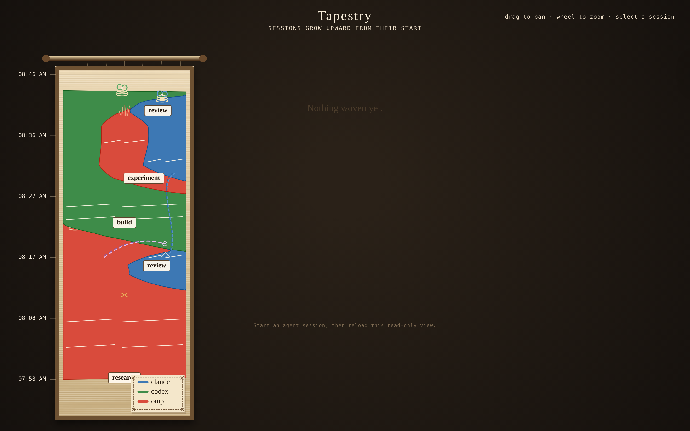
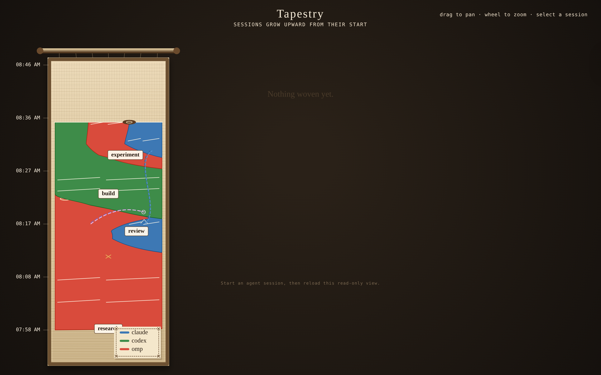

# The Tapestry — implemented vertical session history

The runtime Tapestry is a read-only projection of the sealed daily shards.
Sessions grow upward from their start. The renderer hangs that history as
linen on a rod. Threads begin at the lower left, sit edge to edge, and fill
out to both selvedges. A thread that ends gives its width back toward the
left. The cloth is only as wide as the weave, so a new session can still
extend it to the right.

## Runtime

    ~/.local/state/omarchy/agents/logs/*.jsonl
            │  eventloom tapestry [--port 4747] [--days N]
            ▼
      read-only weave JSON: normalized stitches
            ▼
      index.html + weave.js: pan/zoom canvas and inspector

The server never changes a shard. It reads the Eventloom envelope fields:
timestamp, actorId, threadId, payload, and integrity.

For visual and renderer testing, eventloom tapestry --demo serves a
deterministic in-memory weave. It includes a dense completed build, a resumed
review, a handoff, and a failed experiment; it neither reads nor writes logs.

## Visual encoding

| Element | Source | Rendering |
|---|---|---|
| Session upright | contiguous events sharing a session or actor/thread fallback | grows upward from its first event |
| Height | session elapsed time | shared vertical time ruler |
| Activity envelope | rolling event count, weighted slightly by duration | width expands through bursts and contracts in quiet stretches |
| Yarn dye | actor | color in plies; never a fixed spatial lane |
| Weave texture | event family | tools = running stitch; approval = warm cross-weave; failures = frayed end |
| Resume splice | agent.session.resumed | same-dye broken loop linking consecutive segments |
| Handoff cord | agent.handoff carrying a receiving session id | violet dashed strand to the recipient start |
| Completion cap | agent.session.completed or goal_completed | bright bound terminal seam and completion knot |

## Activity width

Every contiguous segment is sampled into fixed wall-clock buckets—short
buckets in a day view, daily buckets in a multi-day view. A small rolling
window smooths counts and maps normalized activity to a bounded half-width.
Width therefore varies *within* a session. A long quiet session is tall and
threadlike; a compact burst blooms wide.

Aggregation never compromises evidence: every bucket retains its exact event
ids, and the session inspector remains backed by the sealed records.

## Interaction

- Drag pans; wheel zooms.
- On load the warp is dressed, then a shuttle throws the weft upward from the start of the record. `prefers-reduced-motion` skips that.
- Actor dye is a stitched patch in the lower right. Session cards name the session only.
- Select an upright to inspect actor, session, time range, event count, tools,
  approvals, and outcome.
- Resume splices and handoff cords persist as session context.
- The inspector is a projection; full integrity verification remains
  eventloom verify.

## Projection fields

    { id, sessionId, actor, start, end, events, activity[], status,
      completion, failure, resumeOf, column, seed }

These fields are disposable. Deterministic placement and seeded material
variation mean the same shard rebuilds to the same tapestry. Columns are
packed: overlapping segments do not share one. `resumeOf` is set only for
`agent.session.resumed`. Events with no usable timestamp are listed in
`skipped` and do not move the time domain.
