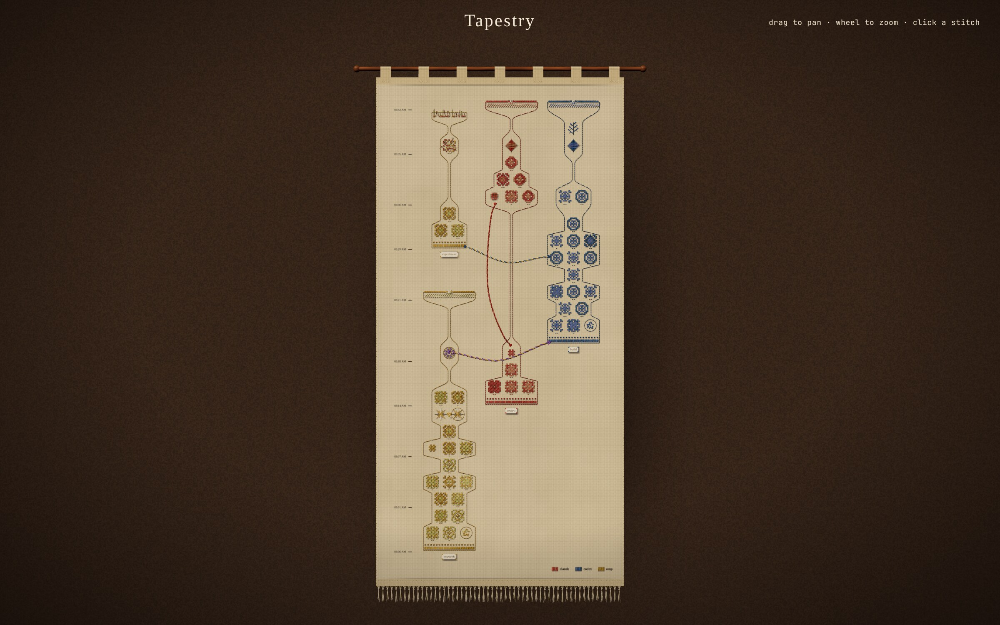
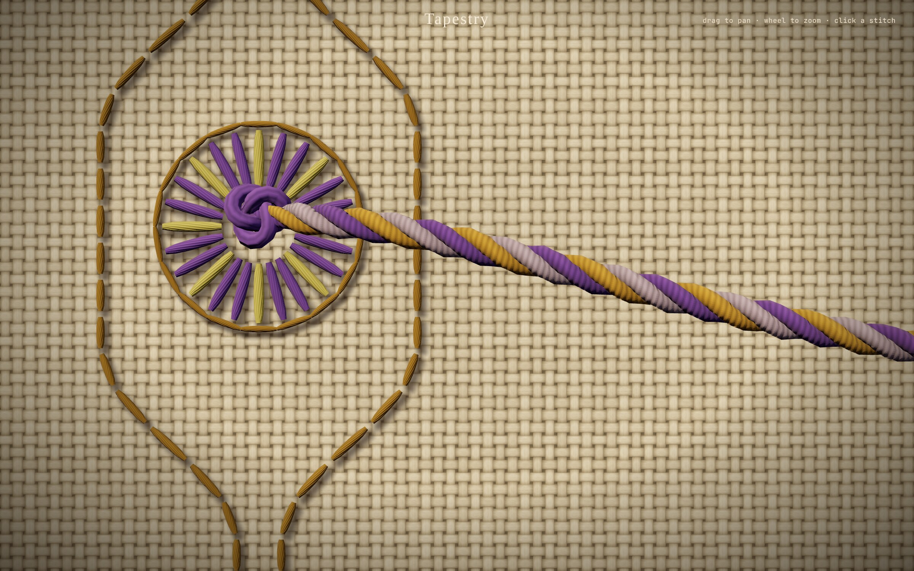
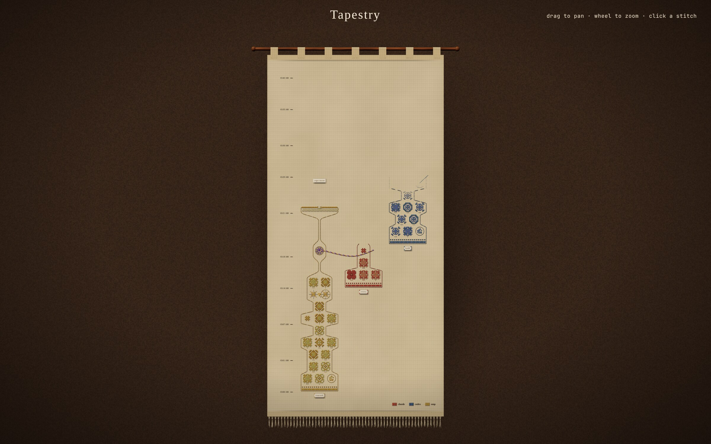

# The Tapestry — the log, embroidered

The runtime Tapestry is a read-only projection of the sealed daily shards,
drawn as needlework. The ground is evenweave linen hung from a rod. Every
action an agent logs is embroidered onto it as its own counted design, each
session is a band of designs that grows upward from its start, and whatever
links one log line to another is a length of plied yarn.

## Runtime

    ~/.local/state/omarchy/agents/logs/*.jsonl
            │  eventloom tapestry [--port 4747] [--days N|all] [--correlation goal-id]
            │  page address: ?days=N for the last N daily shards, none for the whole log
            ▼
      server.mjs: read-only weave JSON (stitches, links)
            ▼
      layout.mjs: actions, bands, rows      motif.mjs: stitches per action
            ▼
      weave.js + fabric.js + yarn.js: the three.js scene

The server never changes a shard. It reads the Eventloom envelope fields:
timestamp, actorId, threadId, parentEventId, causedBy, payload, and
integrity. When a payload carries `occurred_at`, that is the event's time;
otherwise the envelope timestamp is. `eventloom.shard.anchored` lines are
bookkeeping and are not woven.

The page is served to this machine only: requests must be `GET`/`HEAD` and
addressed to `127.0.0.1` or `localhost` on the tapestry's port, and only the
tapestry's own files are reachable.

That keeps other machines and other web pages out, but not other users of
this machine, who can connect to a loopback port as freely as the log's owner
can. So `weave.json` is answered only for a request that carries, as
`Authorization: Bearer <key>`, a 256-bit key the server makes at start-up;
anything else gets 401. The key reaches the owner's browser through
`~/.local/state/omarchy/agents/tapestry/launch-<port>.html`, a file of mode
`0600` in a directory of mode `0700`, which redirects to the tapestry with the
key in the address's fragment. The page moves it to `sessionStorage` and out
of the address bar. The key is never put in an address handed to a program,
because a command line can be read by anyone; `eventloom tapestry` prints the
file's path and the plugin opens the file. The file is removed when the
server stops, and the next server makes a new key. The page's own files need
no key: they are this repository's code and hold nothing from the log.

`weave.json` carries named fields per log
line (type, tool, actor, session, time, duration, outcome, a short hash, and
a few short payload labels such as `model` or `status`). Payloads themselves
stay in the shard.

`--correlation <goal-id>` filters the projection to stitches with that
correlation (including Fleet's `payload.goal_id`); the browser form is
`?correlation=<goal-id>` on the tapestry's address. Filtering changes only the
disposable weave, never the shard or its integrity chain.

`eventloom tapestry --demo` serves a deterministic in-memory weave: a
research session that asks for approval and hands off, the build that
receives it, a review that is resumed, and a forked experiment that fails.
It neither reads nor writes logs.

three.js r170 is a pinned dependency (`three` 0.170.0 in `package-lock.json`,
MIT), installed with the runtime and served by the tapestry server itself, so
the view works offline and loads nothing from the network.

## From log lines to stitches

**Actions.** One design per action, not per log line. A tool's
`agent.tool.started` and its `agent.tool.completed`/`failed` are the same
piece of work and are stitched once; the inspector still lists both sealed
lines.

**Bands.** A band is a session. Log lines with no session id are gathered
into one band per actor. A band holds between one and ten designs abreast,
by how busy the session was.

**Rows.** Time runs up the cloth. Actions are gathered into short runs of
wall-clock time; each run takes as many rows as its busiest band needs, and
rows are shared by every band, so anything higher is later. Idle time is
drawn in rather than woven at full length: a long gap becomes a short stretch
of bare linen, marked with a small zigzag on the time ruler.

**Sewing order is log order.** The same shard always produces the same cloth.

## Visual encoding

| Element | Source | Needlework |
|---|---|---|
| Design | one action | a counted pattern of individual thread stitches, each casting its own shadow |
| Tool call | `agent.tool.*` | cross-stitch glyph, eight-fold symmetric, generated from the tool name: `bash` is always one figure, `read` another |
| Duration | `duration_ms` | a tally of short bars under the design, one per order of magnitude |
| Still running | a start with no end | half stitched: only the under-legs of each cross |
| Failure | `*.failed`, non-zero exit | dropped and half stitches, rust thread, frayed ends lifting off the cloth |
| Approval | `agent.approval.*` | Algerian eye in gold; ringed once resolved |
| Model turn | `agent.model.*` | a spiral of French knots |
| File change | `agent.file.mutated` | satin-stitch lozenge |
| Git change | `agent.git.mutated` | feather-stitched branch with knotted tips |
| Note, other types | `agent.note.added`, anything else | smaller counted glyph keyed by subtype |
| Resume | `agent.session.resumed` | a darned patch |
| Session start | `agent.session.started` | cast-on: satin hem under a row of crosses, with a sewn-on name tag |
| Session end | `agent.session.completed` | bound-off herringbone seam and a completion bow |
| Session failed | `agent.session.failed` | ragged row with the ends left hanging |
| Dye | actor | thread colour, with a lighter and darker shade of the same dye; key stitched at the foot |
| Activity | designs per row | the band's backstitched edge widens with busy rows and draws in to a double thread where the session went quiet |

## Yarn

Every way one sealed event points at another is a three-ply yarn that leaves
the cloth at a knot, hangs under its own weight, casts a shadow that widens
as it lifts, and goes back in at another knot.

| Yarn | Source | Plies |
|---|---|---|
| Cause | `parentEventId`, `causedBy` | source dye, target dye, cream |
| Handoff | `agent.handoff` to the first event of the receiving session (`to_session_id`, or `to` as a session or actor) | violet, pale violet, source dye; leaves through the handoff's eyelet |
| Resume | the last event before a resume, when the two are apart on the cloth | the session's own dye in three shades |
| Shared goal | consecutive events with one `correlation_id` in different bands | gold, cream, target dye |

## Interaction

- Drag pans; the wheel zooms about the pointer; `f` or `0` frames the whole
  cloth again. Moving the pointer shifts the view a little, so yarn standing
  off the cloth shows its depth.
- On load the cloth is sewn in log order: each stitch is drawn through, a
  needle rides the newest design, and yarn pays out once both its ends exist.
  `prefers-reduced-motion` shows the finished cloth at once.
- The page polls the log. New lines are stitched onto the cloth already
  there; nothing already sewn is redrawn. A running tool is restitched whole
  when it finishes.
- Hovering a design names it. Clicking one opens the inspector at the
  pointer and sets an embroidery hoop around the design; clicking a band's
  edge or tag inspects the session. Click anywhere else, or press Escape, to
  dismiss it.
- The inspector is a projection; full integrity verification remains
  `eventloom verify`.

## Projection fields

`weave.json`:

    stitches[]  { id, ts, at, type, family, actor, thread, session, correlation,
                  tool, duration, ok, goal_completed, hash, detail }
    links[]     { from, to, kind }        kind: cause | handoff | resume | correlation
    sessions[]  { id, sessionId, actor, start, end, events, activity[], status,
                  completion, failure, resumeOf, column, seed }
    handoffs[], skipped[], span, filter

These are disposable. Events with no usable timestamp are listed in
`skipped` and do not move the time domain.

## Rendering still frames

For screenshots and visual checks the page accepts:

    ?still            finished cloth, no animation, no polling
    ?at=0.6           frozen part-way through the sewing
    ?zoom=x,y,d       frame a detail (cloth units, camera distance)
    ?fit=all          always frame the whole cloth
